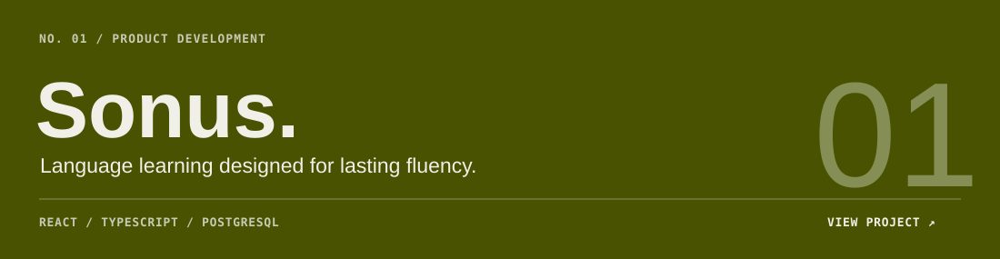
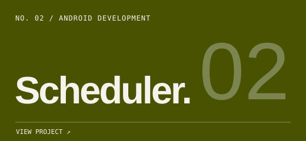
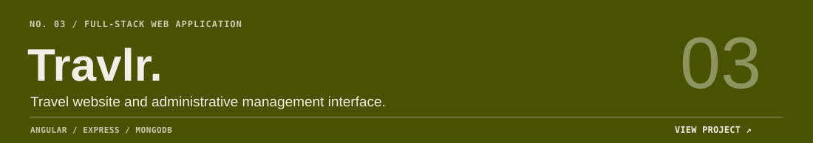

<a href="https://matthewbayers.com">PORTFOLIO ↗</a> &nbsp; · &nbsp; <a href="https://sonuslearning.com/">SONUS ↗</a> &nbsp; · &nbsp; <a href="https://github.com/mbayers6370?tab=repositories">REPOSITORIES ↗</a>

 

