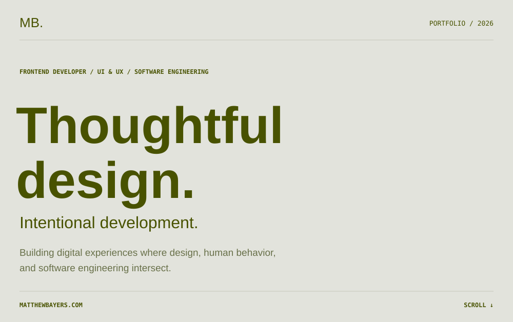
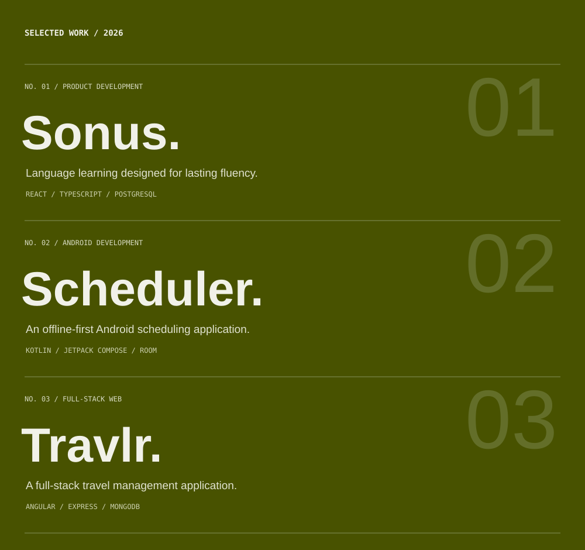
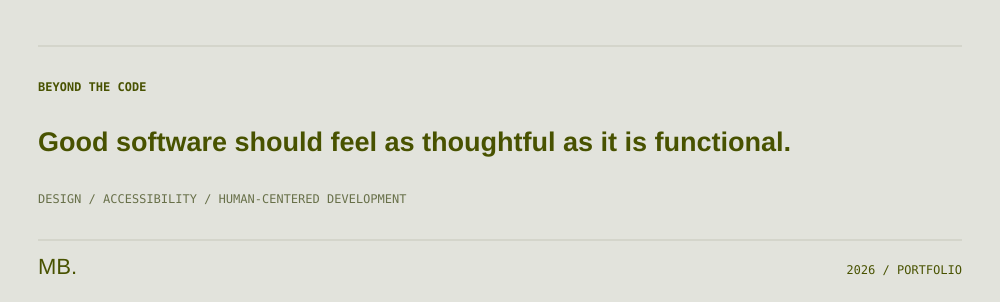

  <a href="https://matthewbayers.com">PORTFOLIO ↗</a> &nbsp;·&nbsp;
  <a href="https://sonuslearning.com/">SONUS ↗</a> &nbsp;·&nbsp;
  <a href="https://github.com/mbayers6370?tab=repositories">REPOSITORIES ↗</a>

**01 — [Sonus](https://github.com/mbayers6370/Sonus)** · [Website](https://sonuslearning.com/)  
A multilingual language-learning platform focused on practical fluency and structured progression.

**02 — [Scheduler](https://github.com/mbayers6370/scheduler)**  
An offline-first Android scheduling application with event management, hierarchical collections, and secure local persistence.

**03 — [Travlr](https://github.com/mbayers6370/CS_465)**  
A full-stack travel management application with a customer-facing site and administrative interface. *(Repository currently named CS_465.)*

<a href="https://matthewbayers.com">matthewbayers.com ↗</a>

