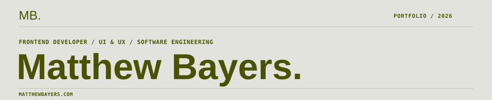

<!-- GitHub profile README — branded to matthewbayers.com -->

 

SELECTED WORK &nbsp; / &nbsp; 2026

<table>
  <tr>
    <td width="50%" valign="top">
      
      
<strong><a href="https://github.com/mbayers6370/Sonus">Sonus ↗</a></strong> Language learning designed for lasting fluency.

      REACT &nbsp; / &nbsp; TYPESCRIPT &nbsp; / &nbsp; POSTGRESQL
    </td>
    <td width="50%" valign="top">
      
      
<strong><a href="https://github.com/mbayers6370/scheduler">Scheduler ↗</a></strong> Offline-first Android scheduling, built with care.

      KOTLIN &nbsp; / &nbsp; JETPACK COMPOSE &nbsp; / &nbsp; ROOM
    </td>
  </tr>
</table>

**[Travlr ↗](https://github.com/mbayers6370/CS_465)** — A full-stack travel application with a customer-facing website and administrative tools.  
ANGULAR &nbsp; / &nbsp; EXPRESS &nbsp; / &nbsp; MONGODB

 

---

ABOUT / APPROACH

I work across product design and software development, with a focus on visual hierarchy, usability, accessibility, and the details that make digital experiences feel cohesive.

**[Portfolio ↗](https://matthewbayers.com)** &nbsp;·&nbsp; **[Sonus ↗](https://sonuslearning.com/)** &nbsp;·&nbsp; **[All repositories ↗](https://github.com/mbayers6370?tab=repositories)**
